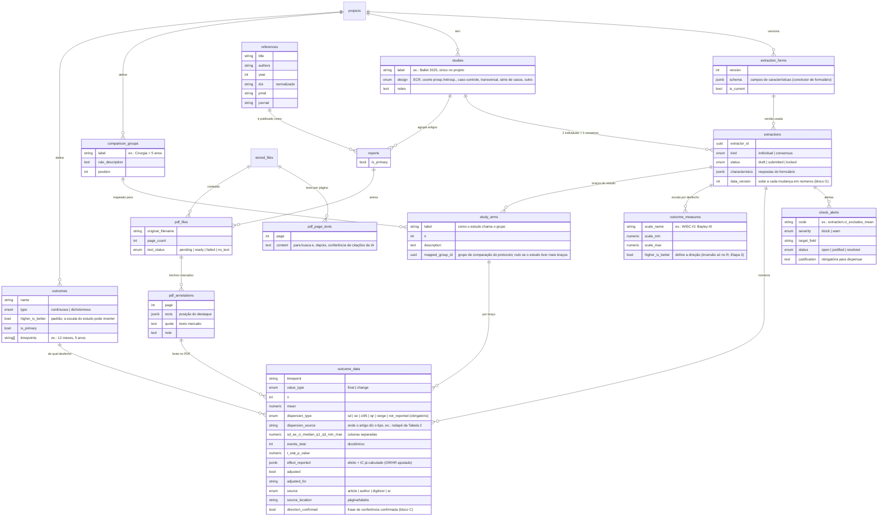

# Modelo de dados — Etapa 1 (proposta para aprovação)

> Refina o rascunho da seção 9 ([modelo-dados.md](modelo-dados.md)) para a Etapa 1: protocolo mínimo, estudos, relatos, PDFs, extração e proteções anti-erro (7.5.1 blocos A, C, D, F e G).
> Todas as tabelas de negócio têm `id` (UUID v7), `project_id`, `created_at`, `updated_at`, `created_by`, `deleted_at` (soft delete) e `version` (trava otimista), omitidos no diagrama.

## Diagrama

## Decisões de modelagem

1. **Dupla extração (decidido: obrigatória, padrão ligado).** Cada estudo tem até **duas extrações individuais** (`kind = individual`, uma por extrator) e **uma de consenso** (`kind = consensus`). As individuais ficam cegas entre si até as duas serem enviadas. A configuração fica em `projects.settings.double_extraction` (o admin pode desligar; desligado, a extração única vira o consenso ao ser enviada).
2. **Digitar uma vez (bloco G).** Análises, exportações e o painel leem **só** a extração de consenso. Qualquer mudança em números dela incrementa `extractions.data_version`; na Etapa 3 cada análise guarda a versão usada e fica "desatualizada" quando ela muda.
3. **Braços por extração.** O `n` de cada braço também é número de desfecho e entra na comparação campo a campo; por isso os braços pertencem à extração, não ao estudo. Estudos com mais de dois braços registram todos; a combinação em dois grupos é feita pelo R na Etapa 3 (fórmula do Cochrane), nunca à mão.
4. **Escala por estudo e desfecho** (`outcome_measures`): estudos medem cognição com escalas diferentes; faixa e direção ficam ali e alimentam o alerta "fora da escala" e a frase de direção.
5. **Alertas persistidos** (`check_alerts`): cada alerta tem estado; dispensar exige justificativa e vai para a auditoria. A lista "Pendências de conferência" e a trava da etapa (bloco F) leem daqui. Os alertas são recalculados quando o dado muda.
6. **Referência mínima agora.** `references` nasce com os campos da lista final (título, autores, ano, DOI, PMID, revista). Importação RIS/BibTeX, buscas e triagem completam a tabela na Etapa 5.
7. **Texto do PDF por arquivo físico.** `pdf_page_texts` liga ao `stored_file` (o mesmo PDF enviado duas vezes é extraído uma vez só), com **pypdfium2** (ADR-012).
8. **Isolamento.** Toda tabela tem `project_id`, inclusive as filhas, para que toda consulta filtre por projeto e o teste de isolamento cubra cada rota nova.

## Fora desta etapa (já previsto no modelo)
- Conversões, combinação de braços, detector de EP e influência (blocos B e E) → Etapa 3, no serviço R.
- Inversão de sinal de escalas "maior é pior" → Etapa 3, só no R.
- Contato com autores, motivos de exclusão, triagem → Etapas 5 e 6.
