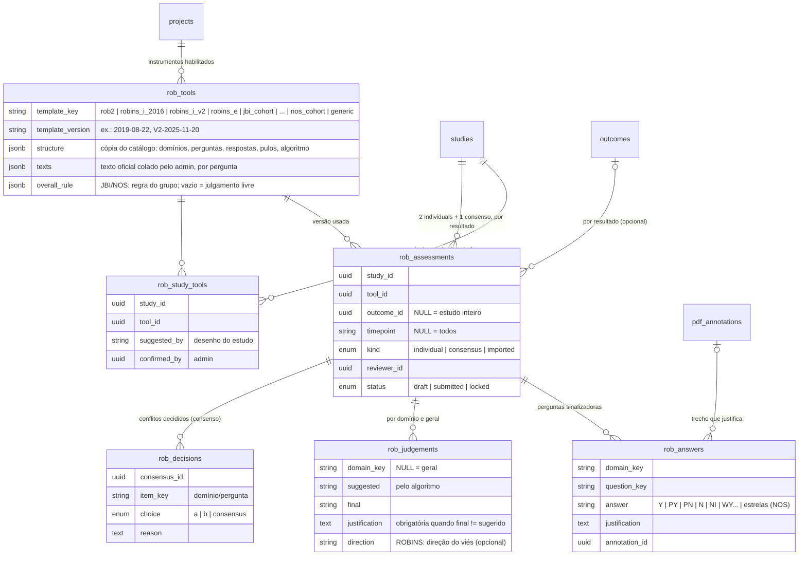

# Modelo de dados — Etapa 2 (proposta para aprovação)

> Risco de viés e migração (docs/modulos.md 7.6; roteiro, Etapa 2). Refina o rascunho da seção 9 ([modelo-dados.md](modelo-dados.md)).
> Todas as tabelas de negócio têm `id` (UUID v7), `project_id`, `created_at`, `updated_at`, `created_by`, `deleted_at` (soft delete) e `version` (trava otimista), omitidos no diagrama.

## Versões atuais dos instrumentos (verificado em 2026-11-14)

| Instrumento | Versão atual | Domínios | Gráfico no robvis fixado (`0c59cf1`) | Observação |
|---|---|---|---|---|
| RoB 2 | 22 ago 2019 (BMJ 2019) | 5 | `ROB2` | Recomendado pelo Cochrane Handbook 6.5 |
| ROBINS-I | **V2, rascunho revisado de 20 nov 2025** (a versão original é de 2016) | 6 na V2 (sai "desvios das intervenções pretendidas"); 7 na de 2016 | `ROBINS-I` só para a de 2016; V2 pelo template `Generic` | V2 tem respostas "forte/fraco" em parte das perguntas e algoritmos oficiais. Licença CC BY-NC-ND 4.0 |
| ROBINS-E | Higgins et al., Environ Int 2024 | 7 | `ROBINS-E` | |
| JBI | Coorte revisado (JBI Evid Synth 2025;23(3):441-53); transversal analítico revisado (2025); demais em revisão gradual | por desenho | não existe template (lição L17) | Sem escore oficial |
| Newcastle-Ottawa | sem versão nova | coorte e caso-controle | não existe template (lição L17) | Sem corte universal |

O robvis do CRAN chegou à 0.3.1 (jun 2026), mas a mudança foi só de contato e citação; a versão fixada do GitHub continua necessária por causa de "Sem informação" no ROBINS-I (lição L16).

## Diagrama

## Decisões de modelagem

1. **Catálogo no código, cópia no projeto.** Os templates (estrutura de cada instrumento) ficam em arquivos JSON versionados no backend, **sem o texto oficial das perguntas** (regra 0.1.7). Ao habilitar um instrumento, o projeto recebe uma cópia (`rob_tools`) com a versão do template. O admin cola o texto oficial de cada pergunta a partir da fonte, se o grupo tiver permissão (pergunta 17.4). Sem texto colado, a tela mostra o número da pergunta e o nome do domínio.
2. **Versão registrada em cada avaliação** (lição L3): a avaliação aponta para a cópia do instrumento; uma versão nova do template vira outra cópia, e as avaliações antigas continuam com a versão que usaram.
3. **Instrumento sugerido pelo desenho, confirmado pelo admin** (`rob_study_tools`): coorte → JBI coorte / NOS coorte / ROBINS-I conforme o que o projeto habilitou; ECR → RoB 2. A sugestão nunca vira escolha sem confirmação.
4. **Por estudo ou por resultado.** `outcome_id` e `timepoint` vazios = avaliação do estudo inteiro (JBI, NOS); preenchidos = por resultado (RoB 2, ROBINS-I, ROBINS-E).
5. **Dupla avaliação cega e consenso, no mesmo padrão da extração** (Etapa 1): duas avaliações individuais cegas até as duas serem enviadas; o admin compara pergunta a pergunta e domínio a domínio, decide cada conflito (A, B ou o valor do consenso com justificativa) e envia o consenso. Terceiro revisor opcional = o admin chama outra pessoa para decidir; fica registrado quem decidiu.
6. **Julgamento sugerido, decisão humana** (0.2): o sistema sugere o julgamento de cada domínio e o geral pelo algoritmo do template; discordar exige justificativa. RoB 2 geral: Baixo se todos Baixo, Alto se algum Alto, senão Algumas preocupações (com aviso de que várias "algumas preocupações" podem justificar Alto). ROBINS: o pior domínio. JBI/NOS: a regra que o grupo configurar; sem regra, julgamento geral livre e obrigatório. **Nenhuma nota total JBI.**
7. **Importação da tabela consolidada** (migração): CSV/XLSX no formato do robvis (Study, D1…Dn, Overall, Weight) ou com mapeamento de colunas, prévia e erros por linha. Vira avaliação `imported` (sem perguntas sinalizadoras), marcada como tal em todas as telas e exportações.
8. **Trava da etapa** reaproveita `stage_events` da Etapa 1 (estágio `risk_of_bias`).

## Fora desta etapa
- Kappa da avaliação de risco de viés é P1, mas sai quase de graça com o `/kappa` da Etapa 1; entra se couber.
- Uso na meta-análise (sensibilidade sem alto risco, subgrupo por risco de viés) → Etapas 3 e 4. Forest plot com semáforo → Etapa 4.
- IA como segunda opinião (IA4) → Etapa 7.
