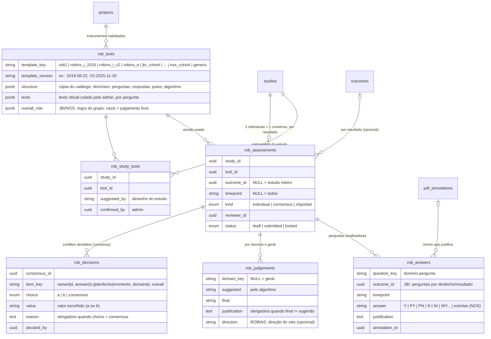

# Modelo de dados — Etapa 2 (aprovado em 2026-11-14)

> Risco de viés e migração (docs/modulos.md 7.6; roteiro, Etapa 2). Refina o rascunho da seção 9 ([modelo-dados.md](modelo-dados.md)).
> Todas as tabelas de negócio têm `id` (UUID v7), `project_id`, `created_at`, `updated_at`, `created_by`, `deleted_at` (soft delete) e `version` (trava otimista), omitidos no diagrama.

## Versões atuais dos instrumentos (verificado em 2026-11-14)

| Instrumento | Versão atual | Domínios | Gráfico no robvis fixado (`0c59cf1`) | Observação |
|---|---|---|---|---|
| RoB 2 | 22 ago 2019 (BMJ 2019) | 5 | `ROB2` | Recomendado pelo Cochrane Handbook 6.5 |
| ROBINS-I | **V2, rascunho revisado de 20 nov 2025** (a versão original é de 2016) | 6 na V2 (sai "desvios das intervenções pretendidas"); 7 na de 2016 | `ROBINS-I` só para a de 2016; V2 pelo template `Generic` | V2 tem respostas "forte/fraco" em parte das perguntas e algoritmos oficiais. Licença CC BY-NC-ND 4.0 |
| ROBINS-E | Higgins et al., Environ Int 2024 | 7 | `ROBINS-E` | |
| JBI | Coorte revisado (JBI Evid Synth 2025;23(3):441-53); transversal analítico revisado (2025); demais em revisão gradual | por desenho | não existe template (lição L17) | Sem escore oficial |
| Newcastle-Ottawa | sem versão nova | coorte e caso-controle | não existe template (lição L17) | Sem corte universal |

O robvis do CRAN chegou à 0.3.1 (jun 2026), mas a mudança foi só de contato e citação; a versão fixada do GitHub continua necessária por causa de "Sem informação" no ROBINS-I (lição L16).

## Diagrama

## Decisões do responsável (2026-11-14)
- **ROBINS-I nas duas versões** (2016 e V2): o projeto escolhe; a versão fica registrada em cada avaliação.
- **Algoritmos de domínio a partir dos documentos oficiais** de cada instrumento, testados com os exemplos dos próprios manuais. O revisor pode discordar com justificativa.
- **Todos os instrumentos da especificação** nesta etapa, na ordem: JBI coorte, ROBINS-I, NOS, RoB 2, ROBINS-E, demais checklists JBI e genérico.

## Decisões de modelagem

1. **Catálogo no código, cópia no projeto.** Os templates (estrutura de cada instrumento) ficam em arquivos JSON versionados no backend, **sem o texto oficial das perguntas** (regra 0.1.7). Ao habilitar um instrumento, o projeto recebe uma cópia (`rob_tools`) com a versão do template. O admin cola o texto oficial de cada pergunta a partir da fonte, se o grupo tiver permissão (pergunta 17.4). Sem texto colado, a tela mostra o número da pergunta e o nome do domínio.
2. **Versão registrada em cada avaliação** (lição L3): a avaliação aponta para a cópia do instrumento; uma versão nova do template vira outra cópia, e as avaliações antigas continuam com a versão que usaram.
3. **Instrumento sugerido pelo desenho, confirmado pelo admin** (`rob_study_tools`): coorte → JBI coorte / NOS coorte / ROBINS-I conforme o que o projeto habilitou; ECR → RoB 2. A sugestão nunca vira escolha sem confirmação.
4. **Por estudo ou por resultado.** `outcome_id` e `timepoint` vazios = avaliação do estudo inteiro (JBI, NOS); preenchidos = por resultado (RoB 2, ROBINS-I, ROBINS-E).
5. **Dupla avaliação cega e consenso, no mesmo padrão da extração** (Etapa 1): duas avaliações individuais cegas até as duas serem enviadas; o admin compara pergunta a pergunta e domínio a domínio, decide cada conflito (A, B ou o valor do consenso com justificativa) e envia o consenso. Terceiro revisor opcional = o admin chama outra pessoa para decidir; fica registrado quem decidiu.
6. **Julgamento sugerido, decisão humana** (0.2): o sistema sugere o julgamento de cada domínio e o geral pelo algoritmo do template; discordar exige justificativa. RoB 2 geral: Baixo se todos Baixo, Alto se algum Alto, senão Algumas preocupações (com aviso de que várias "algumas preocupações" podem justificar Alto). ROBINS: o pior domínio. JBI/NOS: a regra que o grupo configurar; sem regra, julgamento geral livre e obrigatório. **Nenhuma nota total JBI.**
7. **Importação da tabela consolidada** (migração): CSV/XLSX no formato do robvis (Study, D1…Dn, Overall, Weight) ou com mapeamento de colunas, prévia e erros por linha. Vira avaliação `imported` (sem perguntas sinalizadoras), marcada como tal em todas as telas e exportações.
8. **Trava da etapa** reaproveita `stage_events` da Etapa 1 (estágio `risk_of_bias`).

## Achados ao levantar a estrutura (passo 1)
- **JBI revisado avalia por nível.** Nos checklists revisados (coorte 2025, ECR 2023, quase-experimental 2024, transversal 2026), cada pergunta tem um nível: estudo, desfecho ou resultado. Por isso a resposta (`rob_answers`) ganha `outcome_id` e `timepoint` opcionais: perguntas de nível "desfecho" são respondidas por desfecho, e as de nível "resultado", por desfecho e momento. Caso-controle e série de casos seguem o formato de 2020 (10 perguntas, todas por estudo).
- **Algoritmos do ROBINS-I V2 são fluxogramas** (imagem) no documento oficial; serão transcritos domínio a domínio e testados com os exemplos do manual (passo 1b).
- **O documento JBI proíbe reprodução** ("Unauthorized reproduction of this article is prohibited"): confirma que só a estrutura entra no sistema.

## Algoritmos transcritos (passo 1b)
Cada algoritmo de domínio fica no template como uma árvore de decisão, nó a nó como no fluxograma oficial (`app/modules/risk_of_bias/algorithm.py` descreve os tipos de nó). Os testes (`tests/test_rob_algorithm.py`) percorrem caminhos de cada fluxograma e verificam, com milhares de respostas sorteadas, que as regras de "pular pergunta" nunca escondem uma pergunta de que o algoritmo precisa.

| Instrumento | Fonte dos algoritmos | Julgamento geral |
|---|---|---|
| ROBINS-I V2 (rascunho de 20 nov 2025) | fluxogramas das págs. 20–47 | pior domínio; aviso se vários "moderado" ou "grave" |
| RoB 2 (22 ago 2019) | cribsheet oficial, págs. 6–23 | regra oficial; aviso se várias "algumas preocupações" |
| ROBINS-E (24 mar 2024) | fluxogramas das págs. 25–62 | pior domínio; aviso se vários "alto" |
| ROBINS-I 2016 | sem algoritmo oficial de domínio: o revisor julga | Tabela 3 oficial (crítico > grave > sem informação > moderado > baixo) |

Divergências encontradas nos documentos oficiais estão registradas em `source_notes` de cada template (por exemplo, o rótulo "SY" na pergunta 3.1 do ROBINS-I V2, que pelas opções e pela condição da 3.6 é "SN").

## Avaliação individual cega (passo 2)
- **Cegamento:** quem não é o dono da avaliação recebe 404 (como se ela não existisse); só o admin vê todas. No máximo 2 avaliações individuais por estudo e resultado.
- **Escopo:** instrumentos "por resultado" (RoB 2, ROBINS-I, ROBINS-E) exigem desfecho e momento ao iniciar; JBI e NOS avaliam o estudo, e as perguntas de nível desfecho/resultado do JBI são respondidas uma vez para cada desfecho/momento do protocolo.
- **Variantes:** domínios com versões alternativas (ex.: D1 do ROBINS-I V2, A ou B) pedem a escolha antes das perguntas.
- **Sugestão × julgamento:** o sistema guarda a sugestão do algoritmo junto do julgamento final; discordar exige justificativa. O envio só acontece sem pendências (`rob.incomplete` lista o que falta).
- **Regra do grupo (JBI, NOS e genérico):** sem ponto de corte oficial, o admin pode definir uma regra em `rob_tools.overall_rule`: níveis de um conjunto pronto (baixo/moderado/alto, baixo/alto ou boa/razoável/ruim), casos conferidos em ordem (contagem de respostas, opcionalmente só em algumas perguntas, ou total de estrelas no NOS) e um nível padrão. Sem regra, o julgamento geral é livre e obrigatório. Nunca há "nota total" para o JBI.
- **Imutabilidade:** depois da primeira avaliação, o instrumento do estudo e a estrutura do instrumento genérico não podem mais mudar (`rob.study_has_assessments`, `rob.tool_in_use`).

## Conflitos, consenso e concordância (passo 3)
- **Comparação** (só admin): para cada estudo ou resultado avaliado, as duas avaliações enviadas lado a lado: versão do domínio, respostas, julgamentos de domínio e julgamento geral, com as justificativas. Enquanto não houver duas enviadas, nenhuma resposta é mostrada (cegamento).
- **Só o que foi perguntado conta:** respostas guardadas em perguntas que as regras do instrumento pularam são ignoradas, para não virarem conflitos falsos.
- **Consenso:** começa com as respostas do revisor A, completadas com as do B onde A deixou em branco. Cada conflito é decidido como A, B ou "valor do consenso" (editado na própria avaliação de consenso, com motivo de pelo menos 5 caracteres). O consenso só é enviado sem conflitos pendentes (`rob.undecided_conflicts`) e com todas as regras de uma avaliação normal. Quem decide fica registrado; o terceiro revisor é um admin do projeto.
- **Concordância** (R, `/kappa`): por par, % de itens iguais e kappa de Cohen sobre todos os itens (todos são categorias). No projeto, % e kappa só nos julgamentos (domínios e geral) de todos os pares. Se o R estiver fora do ar, a tela funciona e avisa.
- **Visibilidade:** depois de criado, o consenso é visível a todos os membros; as avaliações individuais continuam cegas para os outros revisores.

## Tabela consolidada e gráficos (passo 4)
- **Tabela** (`GET /rob/table`): um quadro por instrumento. Estudos x domínios (RoB 2, ROBINS) ou estudos x perguntas (JBI, Newcastle-Ottawa, genérico), mais o julgamento geral. Instrumentos por resultado, e checklists com perguntas por desfecho, mostram um desfecho e um momento por vez.
- **Só entra o consenso enviado** (ou a avaliação importada, passo 6). Os outros estudos aparecem numa lista à parte, com o motivo: nenhuma avaliação, avaliações em andamento ou consenso não enviado.
- **Gráficos** (`POST /rob/plots`): semáforo ou resumo por domínio, em SVG ou PNG a 300 dpi, no idioma escolhido para a saída. Se algum estudo ficaria de fora, o gráfico só sai com confirmação explícita (`rob.plot_missing_studies`), e a resposta informa quantos ficaram de fora. Engine: ver ADR-013.
- Respostas a perguntas puladas pelas regras do instrumento aparecem como "não se aplica".

## Exportações (passo 5)
- `GET /exports/risk-of-bias` (mesma tabela consolidada, mesmo instrumento e resultado):
  - **XLSX**: abas Leia-me (projeto, instrumento e versão, resultado, data, origem dos dados, aviso de que JBI/NOS não têm nota total, estudos que ficaram de fora e por quê), Risco de viés, Legenda das colunas e Justificativas do consenso.
  - **DOCX**: as mesmas informações, em paisagem, com as células coloridas e o texto do julgamento (nunca só a cor).
  - **CSV**: só a tabela, para Excel em português (`;`, UTF-8 com BOM) ou para o R (`,`).
  - **CSV do robvis**: formato de entrada do robvis (`Study, D1…Dn, Overall, Weight`), com os julgamentos nas palavras que o robvis espera, em inglês. Só para RoB 2 e ROBINS-I 2016, os instrumentos que o robvis desenha (ADR-013); nos outros, a exportação é recusada com uma mensagem clara.
- **Nunca em silêncio** (lição L2): se algum estudo do instrumento não tem consenso enviado, o arquivo só sai com confirmação explícita (`rob.export_missing_studies`), e o leia-me lista quais ficaram de fora.
- Os rótulos seguem o idioma escolhido para a saída, independente do idioma da tela (ADR-008).
- Nova dependência: `python-docx` (MIT, mantida; já prevista na seção 3.2).

## Importação da tabela existente (passo 6)
- `POST /rob/imports/preview` e `POST /rob/imports` (só admin), no mesmo padrão da importação de estudos: prévia com sugestão de colunas, simulação com erros por linha e importação das linhas válidas.
- **Formato:** robvis (`Study, D1…Dn, Overall, Weight`; a coluna `Weight` é ignorada) ou qualquer CSV/XLSX com o mapeamento feito na tela. Em checklists (JBI, NOS, genérico), as colunas são as perguntas e só estudo e julgamento geral são obrigatórios. Uma coluna opcional pode trazer a justificativa do julgamento geral.
- **Valores:** só os níveis do instrumento, escritos em português, em inglês, como o robvis escreve ("Low", "Some concerns", "Serious risk"…) ou pelo código. Qualquer outro valor vira erro na linha (`rob_import.unknown_value`), nunca um palpite.
- **Estudos:** cada linha precisa de um estudo já cadastrado, encontrado pelo nome. Se o estudo ainda não tinha instrumento confirmado, a importação confirma este. São recusados: estudo desconhecido, repetido no arquivo, com outro instrumento ou que já tem consenso ou importação para o resultado. Nada é sobrescrito.
- **Resultado:** avaliações `kind = imported`, enviadas, sem perguntas sinalizadoras (exceto as respostas dos checklists). Aparecem como "importada" na tabela e nas exportações e ficam na auditoria.
- **Limitação conhecida:** num checklist com perguntas por desfecho (JBI), cada estudo é importado para um único desfecho e momento.

## Revisão e trava (passo 7)
- `GET /rob/review` mostra cada estudo: instrumento confirmado e, para o estudo ou cada resultado avaliado, se a avaliação final está pronta, se falta o consenso ou se as avaliações individuais estão em andamento.
- **Trava** (`POST /rob/review/lock`, só admin): exige todos os estudos concluídos, ou seja, instrumento confirmado, pelo menos uma avaliação final (consenso enviado ou importação) e nada pela metade. As avaliações finais passam a `locked`, e toda escrita da etapa é recusada (`stage.locked`). **Destravar** exige justificativa.
- Com a etapa aberta, o admin pode **reabrir um consenso** enviado para corrigir, ou **descartar uma importação** (soft delete) para importar de novo. As duas ações exigem justificativa e ficam no histórico da etapa.

## Fora desta etapa
- Uso na meta-análise (sensibilidade sem alto risco, subgrupo por risco de viés) → Etapas 3 e 4. Forest plot com semáforo → Etapa 4.
- IA como segunda opinião (IA4) → Etapa 7.
